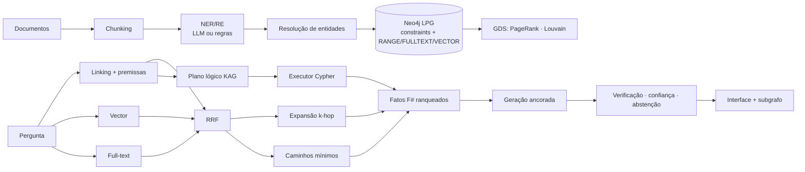

# GraphRAG & KAG sobre Neo4j — História da Computação

Projeto Final da disciplina **Tendências em Ciência da Computação** (Bacharelado em Ciência da Computação, 2026).
Docente: Prof. Ricardo Roberto de Lima.

**Autor:** Caio Dantas da Silveira

Sistema de perguntas e respostas que transforma textos em um **grafo de conhecimento LPG no Neo4j** e responde perguntas complexas (multi-hop) combinando **busca vetorial, full-text e travessia Cypher**, com **raciocínio por forma lógica (KAG)**, **citação dos caminhos do grafo** e **mecanismos explícitos contra alucinação**.

> Exemplo: *“Onde trabalhava o orientador de Alan Turing?”* — nenhum trecho do corpus responde isso sozinho. O sistema planeja `Alan Turing ←ADVISED− x₁ −WORKED_AT→ x₂`, executa no grafo e responde *Universidade de Princeton (via Alonzo Church)*, citando os fatos `[F1]`, `[F2]` e os trechos de origem.

---

## Sumário

1. [Requisitos atendidos](#1-requisitos-atendidos)
2. [Arquitetura](#2-arquitetura)
3. [Instalação e execução](#3-instalação-e-execução)
4. [Configuração (LLM, embeddings, backends)](#4-configuração)
5. [Uso: CLI e interface](#5-uso)
6. [Testes](#6-testes)
7. [Avaliação e resultados](#7-avaliação-e-resultados)
8. [Estrutura do repositório](#8-estrutura-do-repositório)
9. [Créditos e bibliotecas](#9-créditos-e-bibliotecas)
10. [Limitações](#10-limitações)

---

## 1. Requisitos atendidos

| Pilar / critério da rubrica | Implementação | Onde |
|---|---|---|
| **3.1 Text-to-Graph** — NER e RE automatizados | Extrator LLM guiado pelo esquema (JSON validado: tipos, domínio/alcance, direção) + extrator por regras offline (dicionário com *longest match* + padrões lexicais em português) | `graphrag/extraction.py` |
| Resolução de entidades | Cascata por tipo: alias normalizado → sobrenome → contenção de tokens → fuzzy (com guarda para tokens curtos) → embedding; aliases aprendidos | `graphrag/resolution.py` |
| Esquema dinâmico ou pré-definido | Ontologia com domínio/alcance; `SCHEMA_MODE=strict` ou `dynamic` (registra novos tipos de relação) | `graphrag/ontology.py` |
| **3.2 Modelagem LPG** | `Entity` + rótulo de tipo; camadas `Document`/`Chunk`; `Community`; proveniência na aresta (`sources`) | `docs/modelagem_lpg.md` |
| Constraints e índices | 10 constraints de unicidade; índices RANGE (sucessor do B-tree), FULLTEXT (`brazilian` em chunks) e VECTOR (HNSW/cosseno) | `graphrag/store/cypher.py` |
| **3.3 Busca híbrida** | Vetor (chunks e entidades) + full-text Lucene + entity linking, fundidos por *Reciprocal Rank Fusion* | `graphrag/retrieval.py` |
| Multi-hop (≥ 2 saltos) | Expansão `[:REL*1..k]`, `allShortestPaths` entre âncoras e executor KAG encadeado com poda para trás | `retrieval.py`, `kag.py` |
| Algoritmos de grafo | PageRank e Louvain (Neo4j GDS, com *fallback* NetworkX) + resumos de comunidade; PageRank pondera os caminhos | `graphrag/algorithms.py` |
| Geração de Cypher via LLM | Text2Cypher com validador (só leitura, esquema, LIMIT), `EXPLAIN` e autocorreção; KAG com Cypher por template | `text2cypher.py`, `kag.py` |
| Mitigação de alucinações | Contexto só com fatos numerados; citação obrigatória; detecção de premissa falsa; verificação pós-geração; abstenção abaixo do limiar | `graphrag/generation.py` |
| **3.4 Interface** | Streamlit com 4 páginas (Perguntar, Ingestão, Explorar, Avaliação) | `app/streamlit_app.py` |
| Subgrafo interativo | vis-network: âncoras ◆, resposta em vermelho, caminho do raciocínio destacado, tooltips com fontes | `graphrag/viz.py` |
| Rastreabilidade | Lista de nós/fatos com origem e fonte, plano KAG passo a passo, **todas** as consultas Cypher com parâmetros e tempo, relatório de verificação e **nível de confiança** | interface, aba por aba |
| Qualidade de código e testes | 58 testes automatizados (+3 de integração com Neo4j), backends intercambiáveis, configuração por `.env` | `tests/` |
| Artigo técnico | Formato SBC (`artigo/sbc-template.sty`), com avaliação em conjunto de teste separado | `artigo/` |

## 2. Arquitetura



Detalhes: [`docs/arquitetura.md`](docs/arquitetura.md) · Modelagem: [`docs/modelagem_lpg.md`](docs/modelagem_lpg.md)

**Três modos de recuperação** (para comparação):

| Modo | O que faz |
|---|---|
| `vector` | Baseline: RAG clássico, só chunks por similaridade |
| `graphrag` | Sementes híbridas (RRF) + expansão multi-hop + caminhos mínimos + comunidades + PageRank |
| `kag` *(padrão)* | `graphrag` + plano lógico executado no grafo (+ Text2Cypher quando há LLM e Neo4j) |

## 3. Instalação e execução

Pré-requisitos: **Python 3.10+** e **Docker** (para o Neo4j).

```bash
git clone <url-do-repositorio> graphrag-kag && cd graphrag-kag
python -m venv .venv && source .venv/bin/activate      # Windows: .venv\Scripts\activate
pip install -r requirements.txt
cp .env.example .env

docker compose up -d neo4j          # Neo4j 5.26 + Graph Data Science (aguarde ~30 s)
python -m graphrag build --reset    # schema + ingestão do corpus + PageRank/Louvain
streamlit run app/streamlit_app.py  # http://localhost:8501
```

Neo4j Browser: <http://localhost:7474> (usuário `neo4j`, senha `graphrag2026`).

**Sem Docker (demonstração rápida):** `GRAPH_BACKEND=memory streamlit run app/streamlit_app.py` — usa o backend em memória com a mesma lógica e as mesmas consultas Cypher registradas.

**Tudo em contêiner:** `docker compose --profile app up --build`.

**Deploy em nuvem:** use um banco Neo4j AuraDB (o plano gratuito suporta índices vetoriais; GDS não está disponível nele, e o sistema cai automaticamente para PageRank/Louvain via NetworkX), ajuste `NEO4J_URI=neo4j+s://...` e publique a interface no Streamlit Community Cloud apontando para `app/streamlit_app.py` com as variáveis do `.env` como *secrets*.

## 4. Configuração

Tudo via `.env` (ver `.env.example`).

| Cenário | Variáveis |
|---|---|
| **Offline** (padrão; reprodutível; sem custo) | `LLM_PROVIDER=none`, `EMBEDDING_PROVIDER=hash` |
| **OpenAI** | `LLM_PROVIDER=openai`, `LLM_API_KEY=...`, `LLM_MODEL=gpt-4o-mini`, `EMBEDDING_PROVIDER=openai`, `EMBEDDING_MODEL=text-embedding-3-small`, `EMBEDDING_DIM=1536` |
| **Ollama local (gratuito)** | `LLM_PROVIDER=openai`, `LLM_BASE_URL=http://localhost:11434/v1`, `LLM_MODEL=llama3.1:8b`, `EMBEDDING_PROVIDER=openai`, `EMBEDDING_BASE_URL=http://localhost:11434/v1`, `EMBEDDING_MODEL=nomic-embed-text`, `EMBEDDING_DIM=768` |
| **Groq** | `LLM_PROVIDER=openai`, `LLM_BASE_URL=https://api.groq.com/openai/v1`, `LLM_API_KEY=...`, `LLM_MODEL=llama-3.3-70b-versatile` |

> Ao mudar `EMBEDDING_DIM`, rode `python -m graphrag build --reset` para recriar os índices vetoriais.

Com LLM configurado, ele passa a ser usado em: extração NER/RE, planejamento KAG, Text2Cypher, resumos de comunidade e geração da resposta. Sem LLM, cada etapa usa sua alternativa determinística.

## 5. Uso

### CLI

```bash
python -m graphrag build --reset                    # constrói tudo
python -m graphrag schema                           # mostra/cria constraints e índices
python -m graphrag ingest novos_docs/               # ingestão incremental
python -m graphrag algorithms                       # PageRank + Louvain + resumos
python -m graphrag ask "Em que cidade nasceu o criador da linguagem C?"
python -m graphrag ask "..." --mode vector          # compara com o baseline
python -m graphrag ask "..." --json                 # fatos, plano, verificação e Cypher em JSON
python -m graphrag evaluate                         # avaliação (gera results/)
python -m graphrag stats
python -m graphrag --backend memory ask "..."       # sem Neo4j
```

Saída típica:

```
Dennis Ritchie criou linguagem C (em 1972) [F1]. Dennis Ritchie nasceu em Bronxville (em 1941) [F2].
Resposta: Bronxville (via Dennis Ritchie) [F2].

confiança: 1.00 | gerador: extractive | 14 ms
plano KAG: anchor:technology:linguagem_c -[CREATED|DEVELOPED_AT]- x1 => ['Bell Labs', 'Dennis Ritchie'] ; var:x1 -[BORN_IN]-> x2:Location => ['Bronxville']
  F1: (Dennis Ritchie)-[:CREATED {year: 1972}]->(linguagem C)  fontes=['doc:dennis_ritchie#c0']
  F2: (Dennis Ritchie)-[:BORN_IN {year: 1941}]->(Bronxville)  fontes=['doc:dennis_ritchie#c0']
  ...
```

### Interface (Streamlit)

* **Perguntar** — resposta com citações, medidor de confiança e seis abas: *Subgrafo* (interativo), *Fatos e procedência* (tabela de triplas + trechos de origem), *Plano KAG* (JSON + execução passo a passo + Text2Cypher), *Cypher executado* (todas as consultas com parâmetros e tempo), *Verificação* (relatório e contexto exato enviado ao gerador) e *Recuperação* (âncoras, sementes RRF, chunks, comunidades).
* **Ingestão** — envio de novos `.md/.txt`, com relatório de entidades, relações e resoluções.
* **Explorar grafo** — contagens por rótulo/tipo, ranking de PageRank, DDL do esquema e ontologia.
* **Avaliação** — roda a comparação vetor × GraphRAG × KAG nos dois conjuntos de perguntas.

## 6. Testes

```bash
pytest                                    # 58 testes, ~1 s, sem Docker
docker compose up -d neo4j
NEO4J_TEST_URI=bolt://localhost:7687 pytest tests/test_neo4j_integration.py -v
```

Cobertura por tema: extração (direção de relações, particípios, adjuntos, correferência, validação da saída do LLM, esquema dinâmico), resolução de entidades, segurança de Cypher (escrita, procedimentos, injeção de rótulos), pipeline (unicidade, proveniência, fusão de evidências, ingestão incremental), recuperação/KAG (planos, poda, RRF, log de consultas), alucinação (abstenção, premissa falsa, verificador, substituição por abstenção) e visualização/avaliação. Os testes de integração verificam no Neo4j real a existência dos índices RANGE/FULLTEXT/VECTOR, a constraint de unicidade e a equivalência de respostas entre os dois backends.

## 7. Avaliação e resultados

`python -m graphrag evaluate` compara os três modos. Há **dois conjuntos**:

* **Desenvolvimento** (`data/eval_questions.json`, 21 perguntas) — usado durante o desenvolvimento, inclusive para ajustar o planejador heurístico; portanto, otimista.
* **Teste** (`data/eval_teste.json`, 14 perguntas) — escrito depois e **não** usado para ajustes. É o resultado que reportamos.

Resultados no conjunto de **teste**, modo offline (extração por regras, embeddings por hashing, gerador extrativo):

| Modo | Acurácia | Multi-hop | Precisão resposta | Recall contexto | Abstenção correta | Resp. não suportada ↓ |
|---|---|---|---|---|---|---|
| RAG vetorial | 14% | 0% | 17% | 88% | 0% | 14% |
| GraphRAG híbrido | 57% | 14% | 46% | 100% | 100% | 0% |
| KAG (forma lógica) | **79%** | **57%** | **60%** | 100% | 100% | **0%** |

(Desenvolvimento: 24% / 71% / 100% de acurácia, respectivamente.)

Leitura: o baseline vetorial **tinha** a informação no contexto em 88% dos casos, mas não conseguiu compor os fatos; o grafo leva o recall de contexto a 100% e a decomposição lógica (KAG) é o que transforma isso em respostas corretas multi-hop. Em todas as perguntas sem resposta no corpus, os modos com grafo se abstiveram. As falhas do KAG no teste (ambiguidade *criou* × *desenvolvido em*, salto implícito “país” de uma cidade, aresta direta encurtando o caminho mínimo, restrição por ano não suportada) estão discutidas no artigo.

> Importante: no modo offline o gerador é extrativo, o que penaliza sobretudo o baseline vetorial. Com um LLM configurado, rode `python -m graphrag evaluate` novamente; os arquivos em `results/` e a tabela LaTeX são regenerados.

## 8. Estrutura do repositório

```
graphrag-kag/
├── app/streamlit_app.py          # interface
├── graphrag/                     # pacote principal
│   ├── ontology.py  text.py  config.py  llm.py  embeddings.py
│   ├── extraction.py  resolution.py  ingest.py  algorithms.py
│   ├── linking.py  retrieval.py  kag.py  text2cypher.py  generation.py
│   ├── evaluation.py  viz.py  engine.py  cli.py
│   └── store/  (cypher.py · neo4j_store.py · memory_store.py · base.py)
├── data/
│   ├── corpus/                   # 15 documentos do domínio
│   ├── gazetteer.json            # entidades canônicas e aliases
│   ├── eval_questions.json       # conjunto de desenvolvimento
│   └── eval_teste.json           # conjunto de teste
├── tests/                        # pytest
├── results/                      # saídas da avaliação (.md, .json, .tex)
├── docs/                         # modelagem LPG, arquitetura, prompt do mentor, roteiro da defesa
├── artigo/                       # artigo SBC (LaTeX + PDF) e figuras
├── scripts/gerar_figuras.py
├── docker-compose.yml  Dockerfile  Makefile  requirements.txt  .env.example
```

## 9. Créditos e bibliotecas

Conforme as regras da disciplina, todo código de terceiros está creditado:

| Biblioteca | Uso | Licença |
|---|---|---|
| [Neo4j](https://neo4j.com) 5 Community + [Graph Data Science](https://neo4j.com/docs/graph-data-science/) | banco de grafos, índices, PageRank/Louvain | GPLv3 |
| [neo4j-python-driver](https://github.com/neo4j/neo4j-python-driver) | conexão Bolt | Apache 2.0 |
| [NetworkX](https://networkx.org) | fallback de algoritmos e backend em memória | BSD |
| [NumPy](https://numpy.org) | similaridade vetorial | BSD |
| [Streamlit](https://streamlit.io) | interface | Apache 2.0 |
| [vis-network](https://visjs.github.io/vis-network/) | renderização do subgrafo | Apache 2.0 / MIT |
| [Requests](https://requests.readthedocs.io), [python-dotenv](https://github.com/theskumar/python-dotenv) | cliente HTTP, configuração | Apache 2.0 / BSD |
| [Matplotlib](https://matplotlib.org) | figuras do artigo | PSF |

Não usamos LangChain/LlamaIndex/Neo4j GenAI SDK de propósito: cada etapa (extração, fusão, planejamento, verificação) está implementada de forma explícita para ser explicável na defesa. Ideias de métodos vêm da literatura citada no artigo (GraphRAG — Edge et al., 2024; KAG — Liang et al., 2024; RRF — Cormack et al., 2009). Ferramentas de IA generativa foram usadas como apoio ao desenvolvimento, incluindo o agente mentor configurado com o prompt oficial (`docs/mentor_prompt.md`).

## 10. Limitações

* O extrator por regras depende do dicionário de entidades (ou do campo `subject` do documento) para reconhecer entidades novas; o extrator LLM não tem essa limitação.
* O planejador heurístico cobre relações explícitas na pergunta; saltos implícitos (“em que **país** nasceu…”) e restrições por atributo (“em **1974**”) exigem o planejador LLM.
* Embeddings por hashing capturam sobreposição lexical, não sinonímia; para uso real, configure um modelo neural.
* O corpus é pequeno (15 documentos) e os conjuntos de avaliação também; os números indicam tendência, não significância estatística.
