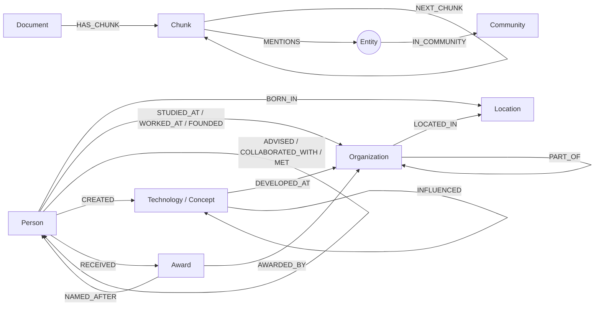

# Fase 1 — Proposta e Modelagem LPG

## 1. Domínio e dataset

**Domínio:** História da Computação — pessoas, instituições, lugares, tecnologias, conceitos e prêmios.

**Por que este domínio?** Ele é rico em relações encadeadas (orientador → instituição; criador → linguagem → laboratório; prêmio → homenageado → universidade), o que permite formular perguntas *multi-hop* cuja resposta não está escrita em nenhuma frase isolada — justamente o caso em que a busca vetorial pura falha e o grafo ajuda.

**Dataset:** 15 documentos em português (`data/corpus/*.md`), um por personalidade/tema, escritos pelo autor a partir de fontes enciclopédicas. Cada arquivo tem um cabeçalho opcional:

```yaml
---
title: Alan Turing
subject: Alan Turing        # entidade principal (usada em correferência)
subject_type: Person        # opcional, padrão Person
source: ...
---
```

Novos documentos podem ser adicionados pela interface (página *Ingestão*) ou pela CLI (`python -m graphrag ingest arquivo.md`).

## 2. Modelo conceitual



O grafo tem duas camadas ligadas por `MENTIONS`:

* **Camada lexical** (`Document`, `Chunk`) — guarda o texto original e seus embeddings. É a base da busca vetorial e da *proveniência*.
* **Camada de conhecimento** (`Entity` + rótulo de tipo) — fatos estruturados extraídos do texto. É a base da travessia multi-hop.

## 3. Rótulos (Labels)

| Rótulo | Descrição | Propriedades |
|---|---|---|
| `Entity` | rótulo base de **toda** entidade (permite um único índice vetorial/full-text e uma constraint global) | `id`, `name`, `type`, `norm_name`, `aliases`, `aliases_text`, `embedding`, `pagerank`, `community`, `created_at` |
| `Person`, `Organization`, `Location`, `Technology`, `Concept`, `Award` | rótulo de tipo, sempre junto com `Entity` (multi-label) | — |
| `Document` | arquivo de origem | `id`, `title`, `source`, `ingested_at` |
| `Chunk` | trecho do documento | `id`, `doc_id`, `idx`, `text`, `embedding` |
| `Community` | comunidade detectada (Louvain) | `id`, `summary`, `size`, `top_entities`, `level` |

**Convenções:** rótulos em *PascalCase* e tipos de relacionamento em *UPPER_SNAKE_CASE* (padrão Neo4j); `id` de entidade é determinístico: `<tipo>:<slug>` (ex.: `person:alan_turing`), o que torna a ingestão idempotente via `MERGE`.

## 4. Tipos de relacionamento

| Tipo | Origem → Destino | Verbalização | Propriedades |
|---|---|---|---|
| `BORN_IN` | Person → Location | nasceu em | todas as relações de domínio têm: `sources` (lista de ids de chunk), `year`, `confidence`, `mention_count`, `evidence`, `extractor` |
| `STUDIED_AT` | Person → Organization | estudou em | |
| `WORKED_AT` | Person → Organization | trabalhou em | |
| `ADVISED` | Person → Person | orientou | |
| `CREATED` | Person → Technology/Concept | criou | |
| `DEVELOPED_AT` | Technology/Concept → Organization | foi desenvolvido em | |
| `COLLABORATED_WITH` | Person ↔ Person (simétrica) | colaborou com | |
| `MET` | Person ↔ Person (simétrica) | encontrou-se com | |
| `INFLUENCED` | qualquer → qualquer | influenciou | |
| `RECEIVED` | Person → Award | recebeu | |
| `NAMED_AFTER` | Award/Technology/Concept → Person | nomeado em homenagem a | |
| `AWARDED_BY` | Award → Organization | é concedido por | |
| `FOUNDED` | Person → Organization | fundou | |
| `LOCATED_IN` | Organization/Location → Location | fica em | |
| `PART_OF` | Organization → Organization | faz parte de | |
| `HAS_CHUNK`, `NEXT_CHUNK`, `MENTIONS`, `IN_COMMUNITY` | estruturais | — | `MENTIONS.count` |

A ontologia é definida em um único lugar (`graphrag/ontology.py`) com **domínio e alcance** de cada relação. Ela é usada para: validar triplas extraídas (inclusive corrigir direção invertida), gerar o texto do esquema para os prompts, escolher a direção dos passos do planejador KAG e validar o Cypher gerado por LLM.

**Esquema estrito × dinâmico:** com `SCHEMA_MODE=strict` (padrão) relações fora da ontologia são descartadas; com `SCHEMA_MODE=dynamic`, o extrator LLM pode propor novos tipos (`RIVALIZOU_COM`), que são sanitizados e registrados em tempo de execução.

**Proveniência no nível da aresta:** cada relação guarda em `sources` os chunks que a afirmam. Se o mesmo fato aparece em dois documentos (ex.: Church orientou Turing), o `MERGE` acumula as duas fontes e incrementa `mention_count`, em vez de duplicar a aresta.

## 5. Constraints e índices

Criados por `python -m graphrag schema` (ou automaticamente no `build`). Código: `graphrag/store/cypher.py::schema_statements`.

| Objeto | Tipo | Justificativa |
|---|---|---|
| `entity_id`: `(e:Entity) REQUIRE e.id IS UNIQUE` | Constraint de unicidade | impede nós duplicados; garante idempotência do `MERGE`; cria índice implícito para lookup por id |
| `person_id`, `organization_id`, ... | Constraint por rótulo de tipo | unicidade também por tipo (consultas que começam por `(:Person {id})`) |
| `document_id`, `chunk_id`, `community_id` | Constraint de unicidade | idem para a camada lexical e comunidades |
| `entity_name`, `entity_norm_name`, `entity_type`, `entity_pagerank`, `entity_community`, `chunk_doc` | Índice **RANGE** | filtros por igualdade/intervalo e ordenação (`ORDER BY pagerank`). No Neo4j 5 o índice B-tree foi substituído pelo RANGE, seu sucessor direto |
| `received_year` em `()-[r:RECEIVED]-()` | Índice RANGE de relacionamento | consultas temporais (“quem recebeu o prêmio em 1974”) |
| `entity_fulltext` em `[name, aliases_text]` | Índice **FULLTEXT** (Lucene) | busca lexical tolerante a erros (`turnig~`) para *entity linking* |
| `chunk_fulltext` em `[text]` com analisador `brazilian` | Índice FULLTEXT | busca por palavra-chave com radicalização em português |
| `chunk_embedding`, `entity_embedding` | Índice **VECTOR** (HNSW, cosseno) | similaridade semântica de trechos e de entidades |

A dimensão do índice vetorial vem de `EMBEDDING_DIM` e precisa bater com o modelo de embeddings (384 para hashing/MiniLM, 768 para `nomic-embed-text`, 1536 para `text-embedding-3-small`).

## 6. Consultas de exemplo (Neo4j Browser)

```cypher
// Constraints e índices criados
SHOW CONSTRAINTS; SHOW INDEXES;

// Multi-hop: onde trabalhava o orientador de Turing?
MATCH (t:Person {name: 'Alan Turing'})<-[:ADVISED]-(adv:Person)-[w:WORKED_AT]->(o:Organization)
RETURN adv.name, o.name, w.year, w.sources;

// Caminho mínimo entre duas pessoas
MATCH (a:Person {name:'Ada Lovelace'}), (b:Person {name:'Claude Shannon'})
MATCH p = shortestPath((a)-[:INFLUENCED|MET|COLLABORATED_WITH|ADVISED*..5]-(b))
RETURN p;

// Busca vetorial em chunks (o vetor vem da aplicação)
CALL db.index.vector.queryNodes('chunk_embedding', 5, $embedding) YIELD node, score
RETURN node.text, score;

// Full-text com tolerância a erro de digitação
CALL db.index.fulltext.queryNodes('entity_fulltext', 'dijstra~') YIELD node, score
RETURN node.name, score;

// Entidades mais centrais
MATCH (e:Entity) RETURN e.name, e.type, e.pagerank ORDER BY e.pagerank DESC LIMIT 10;

// Proveniência de um fato
MATCH (:Person {name:'Alonzo Church'})-[r:ADVISED]->(:Person {name:'Alan Turing'})
UNWIND r.sources AS cid
MATCH (d:Document)-[:HAS_CHUNK]->(c:Chunk {id: cid})
RETURN d.title, c.text;
```

## 7. Estatísticas do grafo construído (modo offline)

| Nós | | Relações | |
|---|---|---|---|
| Entity | 99 | MENTIONS | 156 |
| Organization | 28 | IN_COMMUNITY | 99 |
| Location | 21 | CREATED | 25 |
| Person | 20 | WORKED_AT | 20 |
| Technology | 20 | LOCATED_IN | 18 |
| Concept | 9 | STUDIED_AT | 14 |
| Award | 1 | BORN_IN | 13 |
| Chunk | 23 | DEVELOPED_AT | 11 |
| Document | 15 | outras 9 relações de domínio | 31 |
| Community | 13 | | |
